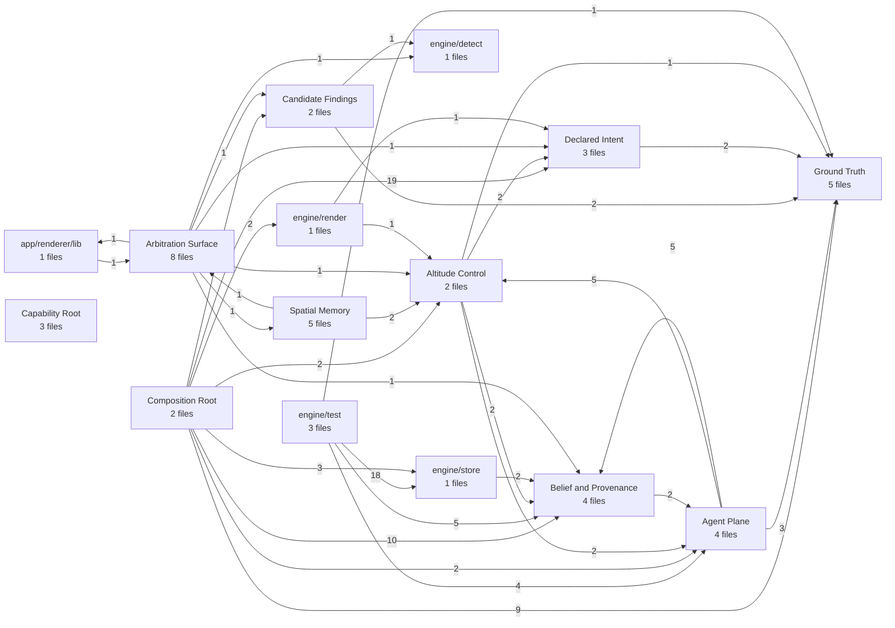

> **P0 record, kept verbatim.** It uses the pre-rename names (`vds`, `VDS_*`, `visual-desloppify`); the product is now Daylight Software Forge and the CLI is `daylight`.

# Architecture

Generated by `vds export`. The JSON beside it is what the tool reads; this is what a
reviewer reads. Do not edit by hand — edit the target or the invariants and re-export.

**L3 status: TRUE** · `visual-desloppify`

## Subsystems

| Subsystem | Files | Purpose |
| --- | --- | --- |
| **Arbitration Surface** | 8 | Where the human closes the stigmergic loop: read what the swarm deposited, see precisely where two sources disagree, and issue the CONFIRMED verdict that outranks every agent and actually removes things from the map. |
| **Spatial Memory** | 5 | Give the graph a body you can fly and navigate back to from memory — position is a pure function of the focus stack with no solver and no randomness, and camera distance IS altitude, so pulling back collapses a node into its agent-named abstraction instead of fading it out. |
| **Ground Truth** | 5 | Turn a repo that may not compile into one exhaustive, content-addressed graph stated in a vocabulary that never names a language — so every claim made above it resolves back to a span, and the language that produced a fact is a swappable provider rather than a property of the map. |
| **Belief and Provenance** | 4 | Accumulate every assertion about the map alongside who made it and what they cited, and keep disagreement alive rather than resolving it — a contradiction is this system's highest-value output, not an error state. |
| **Agent Plane** | 4 | Rent judgment from external agent CLIs and let it back in only as evidenced claims — aim each sandboxed, read-only run at the most uncertain-and-central open question, and make one stdio boundary the only write path that exists. |
| **Capability Root** | 3 | Hold every capability the window is not allowed to have. The renderer displays agent-authored text, so it is treated as untrusted: no filesystem, no spawn, no store — only named operations this process validates, runs and reports back. |
| **Declared Intent** | 3 | Hold the one thing extraction can never derive — what this code is SUPPOSED to be — as machine-checkable declarations that live in the repo they constrain, and express the gap against L0 as either a failing fact or an ordered plan with blast radius attached. |
| **Composition Root** | 2 | Own the only path from a request to a finished artifact — every operation the product performs is wired exactly once here, so the window and the terminal cannot drift, and the outward forms of the map are produced nowhere else. |
| **Candidate Findings** | 2 | Propose — never decide — the specific ways this codebase is redundant or misshapen, emitting tiered candidates that carry their own caveat, because a confident wrong finding is worse than none: it is the one that gets acted on. |
| **Altitude Control** | 2 | Decide what survives at each altitude and keep the collapse lossy rather than a lie — every node enumerates its members, a defended node is never moved, and an elision whose target does not resolve is rejected out loud instead of conjuring a subsystem that does not exist. |
| engine/test | 3 | _unfocused — path grouping_ |
| app/renderer/lib | 1 | _unfocused — path grouping_ |
| engine/detect | 1 | _unfocused — path grouping_ |
| engine/render | 1 | _unfocused — path grouping_ |
| engine/store | 1 | _unfocused — path grouping_ |

## Invariants

- ✅ **engine-has-no-dom** — The engine is headless. It runs under plain Node with no bundler, so a DOM reference typechecks clean under a shared config and then dies at runtime in the CLI.
- ✅ **renderer-never-imports-the-shell** — The renderer reaches the Electron main process only through the preload bridge, never by importing it.
- ✅ **engine-depends-on-nothing-above-it** — The engine is the product and the app is one consumer of it, so nothing in engine/ may reach into app/.
- ✅ **evidence-is-enforced-at-the-store** — Unevidenced claims are rejected where they are ingested, not at review time. The guard lives in the claim store.
- ✅ **agents-run-read-only** — The harness never passes an adapter flag that bypasses approvals or sandboxing.
- ✅ **scene-layout-deterministic** — Nothing under engine/scene/ calls a randomness source. Position is a pure function of the focus stack, so the same repo lays out the same way every session — which is the only thing that makes flying around build spatial memory.

## What was elided to get here

Every collapse is reversible and attributable; a focused map that cannot be
expanded back to its members is indistinguishable from a lie.

- 1 member(s) — vite.config.ts is the build of the window the host serves: it sets root to app/renderer and base './' precisely because production loads the renderer over the custom app:// scheme the main process registers. A one-file build config standing as a peer of Ground Truth and the Agent Plane asserts a subsystem that does not exist — it is a property of the capability root, not a thing beside it.
- 2 member(s) — At architecture altitude a gate belongs with the thing it holds honest, not in a box labelled 'tests'. Both files exist only to exercise the belief calculus and the evidence boundary: smoke.ts drives createServer over an in-memory transport against ClaimStore so an unevidenced write is rejected, and merge-beliefs.ts merges two agent runs through canonicalise/ClaimStore to check corroboration vs CONTRADICTED. Neither is a subsystem; each is the falsifiability of the claim store, and shown beside it they make the store's central claim — disagreement is preserved, not resolved — checkable rather than asserted.
- 1 member(s) — Same argument, different subject: scene.ts imports layoutTree and exists solely because the layouts are where the referent rule keeps getting violated — fake trunks, phantom strata, nodes visible but not hoverable — and pixel-hunting in screenshots cannot catch that. It is the check on the geometry, so it collapses into the geometry rather than standing beside it. With this and the two store gates elided, 'Silent-Failure Gates' correctly ceases to exist at L3: it was never a subsystem, it was three files each belonging to a different one.
